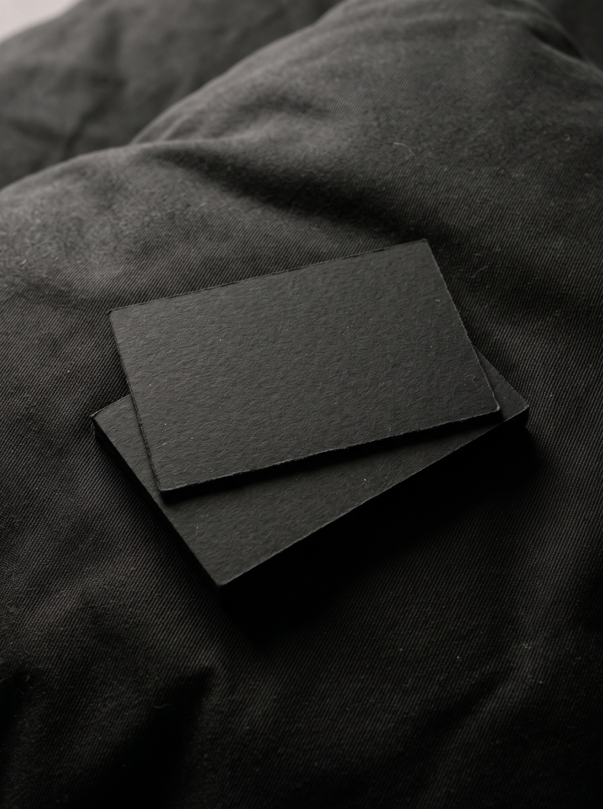

# Mockup Studio

Gerador de mockups de marca que roda no navegador. Você cadastra o **kit da marca** (logo, cores, fontes e textos) e o estúdio aplica tudo em fotos realistas, cenas 3D e composições experimentais. Cada ferramenta tem sliders, variação leve ou agressiva e exportação em alta resolução.

Feito por **DOMO Studio**.



## Ferramentas

| Página | O que faz |
|---|---|
| `index.html` | Página inicial com acesso às ferramentas. |
| `landing.html` | **Landing page em três passos** (marca, conteúdo, página). Monta a página na ordem do caminho de decisão de quem visita: quem é e onde fica, como funciona, preço às claras, avaliações, oferta, extras e fechamento. Mostra por que cada seção está naquela posição, avisa quando a ordem foge da recomendada, confere o contraste das cores e esconde seções sem conteúdo em vez de inventar dados. Exporta um único arquivo HTML responsivo, com imagens e fontes embutidas. |
| `fotos.html` | **Motor de fotos.** Encaixa a arte em perspectiva sobre fotos base. A arte herda a luz, as dobras e a textura da superfície. Acabamentos: impressão, relevo seco, hot stamping (ouro, prata, cobre, grafite), bordado, luminoso e tela emissiva. |
| `mockups.html` | **Estúdio 3D** (Three.js). Sete cenas: cartão sobre tecido, celular entre infláveis, celular com cordas, tablet, caixa de luz, garrafa e bordado. Também é onde os kits de marca são criados e editados. Exporta PNG até ×4 e vídeo MP4 em loop. |
| `thermal.html` | **Thermal / Motion Lab.** Câmera térmica e motion blur em WebGL sobre imagens e tipografia, com exportação em PNG e MP4. |

## Como usar

1. **Kit:** abra o Estúdio 3D e crie um kit com logo, 4 cores, fontes e textos. O kit fica salvo no navegador e pode ser exportado ou importado em `.json`.
2. **Fotos:** no motor de fotos, escolha uma base na faixa inferior. No modo ✎ (tecla `E`), ajuste os 4 cantos da área. Para cada área você define a peça (logo, nome, cartão, padrão, tela, arte própria), a cor, o fundo e o acabamento.
3. **Variar:** `R` gera uma variação leve, `Shift+R` uma agressiva. Cada grupo de controles pode ser travado, e `Ctrl+Z` desfaz.
4. **Exportar:** exporte a base atual ou o pacote com todas as bases, em PNG ou JPG.

## Rodar localmente

São arquivos estáticos, sem build. Por usar `fetch`, as páginas precisam ser servidas por HTTP:

```bash
python -m http.server 5518
# depois abra http://localhost:5518
```

Os kits e as bases enviadas por você ficam salvos no navegador (localStorage e IndexedDB).

## Bases fotográficas

As fotos em `bases/` foram **geradas com IA no Google Flow** (Nano Banana), com upscale 2K. Os prompts pedem superfícies limpas, sem marca, para receber a arte. As áreas de encaixe de cada base ficam em `bases/bases.json`.

Para incluir bases novas, gere ou fotografe uma superfície lisa, sem marca e bem visível para a câmera. Depois adicione pelo botão **+** do motor de fotos, ou inclua a foto no `bases.json`.

## Kit de exemplo

`kits/niko/` traz o kit do **Studio Niko Barber**, cliente da DOMO Studio, como demonstração. A fonte original da marca (Garet) é comercial e não está no repositório. A versão pública usa a Montserrat. Para usar fontes próprias localmente, crie um `kit.local.json` ao lado do `kit.json` (esse arquivo é ignorado pelo Git).

## Tecnologias

- WebGL2 (shaders próprios) para o motor de fotos e o Thermal Lab
- [Three.js](https://threejs.org) para o Estúdio 3D
- [mp4-muxer](https://github.com/Vanilagy/mp4-muxer) e WebCodecs para exportar vídeo
- Google Fonts

A exportação de vídeo MP4 precisa de um navegador com WebCodecs, como o Chrome ou o Edge.
